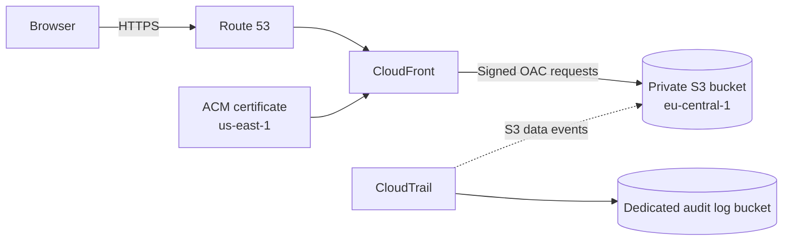

# example.com AWS Static Website

Production-oriented repository for hosting `example.com` and `www.example.com` as a static website on AWS.

The design uses:

- Amazon S3 in `eu-central-1` for website files
- Amazon CloudFront for HTTPS and content delivery
- CloudFront Origin Access Control (OAC) so the S3 bucket can remain private
- AWS Certificate Manager in `us-east-1`, as required by CloudFront
- Amazon Route 53 for DNS
- AWS CloudTrail for management events and S3 object-level data events

## Architecture



## Website source (version 1)

The first version of the website lives in [`website/`](website/). It is built with Pug, SCSS and Bootstrap 5 and is based on the free [Start Bootstrap Grayscale](https://startbootstrap.com/theme/grayscale/) theme.

```bash
cd website
npm install
npm start        # live preview
npm run build    # writes the static files to website/dist/
```

Copy the contents of `website/dist/` into `site/` and deploy them with the scripts below. Photos and videos are not part of this repository; put your own files into `website/src/assets/img/` and `website/src/assets/video/`.

## Repository layout

```text
.
├── website/                  Website source (Pug, SCSS, Bootstrap)
├── site/                     Built static files that get deployed
├── infra/terraform/          Reproducible AWS infrastructure
├── scripts/                  Deployment, export, invalidation and verification scripts
├── docs/                     Setup, security, operations and troubleshooting documentation
└── .github/workflows/        Optional GitHub Actions deployment workflow
```

## Important: website source

This repository cannot automatically contain the current objects from your private S3 bucket until you export them. Run one of the export scripts before the first commit:

```bash
./scripts/export-site-from-s3.sh www.example.com "<PREFIX>"
```

PowerShell:

```powershell
./scripts/export-site-from-s3.ps1 -BucketName "www.example.com" -Prefix "<PREFIX>"
```

The scripts download the existing website into `site/`. Review the files before committing and make sure the folder contains no credentials, private documents or personal exports.

## Quick start

1. Install AWS CLI, Terraform and Git.
2. Configure AWS credentials with a least-privilege administrator role for the initial setup.
3. Export the current website from S3 into `site/`.
4. Copy the Terraform example variables:

   ```bash
   cd infra/terraform
   cp terraform.tfvars.example terraform.tfvars
   ```

5. Fill in `terraform.tfvars`.
6. If resources already exist, import them before applying.
7. Run:

   ```bash
   terraform init
   terraform fmt -check
   terraform validate
   terraform plan
   terraform apply
   ```

8. Deploy the website:

   ```bash
   ./scripts/deploy.sh
   ```

9. Verify DNS, HTTP redirects, HTTPS and selected headers:

   ```bash
   ./scripts/verify.sh
   ```

## Documentation

- [Architecture and design decisions](docs/architecture.md)
- [Initial AWS setup](docs/setup.md)
- [Deploying the website](docs/deployment.md)
- [Security and auditing](docs/security.md)
- [Operations](docs/operations.md)
- [Troubleshooting](docs/troubleshooting.md)

## Safety notes

- Do not commit `terraform.tfvars`, AWS credentials, exported CloudTrail logs or private keys.
- Review every Terraform plan before applying it to an existing AWS account.
- The Terraform bucket policy intentionally removes public object access and grants read access only to the configured CloudFront distribution.
- CloudTrail S3 data events can generate additional charges, especially when logging all `GetObject` requests made by CloudFront.
